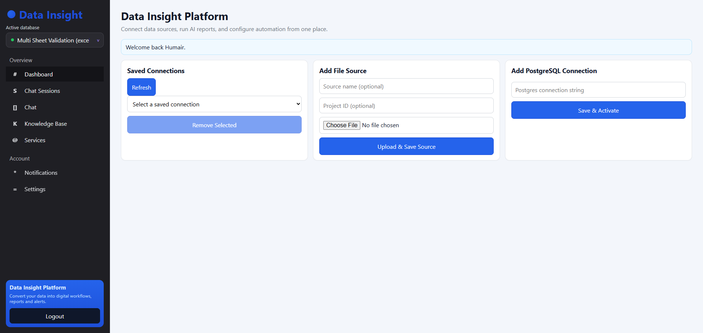

# Data Insight App — PostgreSQL & CSV Analytics with MCP

> **Client-confidential portfolio showcase**
>
> This repository intentionally contains only a curated frontend snapshot from a larger client project. It is shared solely to demonstrate my frontend engineering and product-development skill set. The production backend, MCP servers, AI orchestration, authentication internals, database credentials, client data, tests, infrastructure, and deployment configuration remain private.



<p align="center">
  <strong>React 19 · TypeScript · Vite · Plotly · Responsive Dashboard UI</strong>
</p>

## Product overview

Data Insight is a full-stack business intelligence platform designed to let non-technical users connect structured data, ask analytical questions in natural language, generate reports, and automate recurring data checks.

The complete private application supports PostgreSQL connections, CSV/Excel ingestion, conversational analysis, visual reports, saved sessions, business-context memory, and scheduled monitoring through an MCP-enabled agentic backend.

## Frontend capabilities shown here

- Secure login and account-registration interfaces
- Responsive application shell and navigation sidebar
- Saved-source selection and active-connection switching
- PostgreSQL connection onboarding
- CSV and Excel upload workflows
- Conversational data-analysis interface
- Table and Plotly chart rendering
- CSV export for generated report results
- Chat-session history
- Knowledge-base onboarding and business-context capture
- Automation monitor configuration
- Loading, empty, error, and success states

## Frontend architecture

```text
React application
├── Authentication experience
├── Data-source dashboard
│   ├── Saved connections
│   ├── PostgreSQL onboarding
│   └── CSV / Excel upload
├── Conversational analyst
│   ├── Natural-language prompts
│   ├── Structured tables
│   └── Plotly visualizations
├── Session history
├── Knowledge base
└── Monitoring and automation UI
```

The UI communicates with a private API layer through a configurable `VITE_API_BASE_URL`. The API and MCP implementation are deliberately not included in this public repository.

## Technology demonstrated

- React 19 and modern hooks
- TypeScript
- Vite 7
- Plotly.js and `react-plotly.js`
- Responsive CSS layouts
- REST API integration patterns
- Token-based client authentication flow
- Multi-step forms and file-upload UX
- Typed tables, charts, and session models

## Public repository scope

### Included

- Selected React frontend source
- UI styles and public visual assets
- Frontend build and TypeScript configuration
- Safe environment-variable example
- A dashboard screenshot generated with mocked portfolio data

### Intentionally omitted

- Next.js API and server implementation
- PostgreSQL, MongoDB, CSV/Excel processing internals
- MCP servers and agent orchestration
- LLM prompts, provider configuration, and API credentials
- Authentication secrets and production user records
- Client datasets, uploads, generated reports, and logs
- Tests, deployment configuration, and operational history

## Local UI preview

This repository is a frontend portfolio snapshot, not the complete production system.

```bash
npm install
npm run dev
```

Then open `http://localhost:5173`.

API-backed actions require the private backend and will not operate in this public snapshot. Create a local `.env` only if you have an authorized API environment:

```env
VITE_API_BASE_URL=http://localhost:3000
```

## Confidentiality

This work was produced for a client. No client identity, private business rule, credential, dataset, or production record is intentionally disclosed. The published files are a limited technical showcase and should not be treated as a complete product release or authorization to reproduce the private system.

See [NOTICE.md](NOTICE.md) for the disclosure statement.

## Author

Developed by [humairyousaf6](https://github.com/humairyousaf6).
